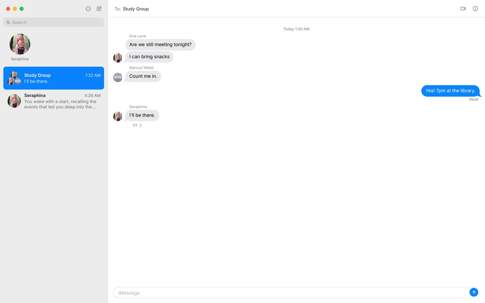
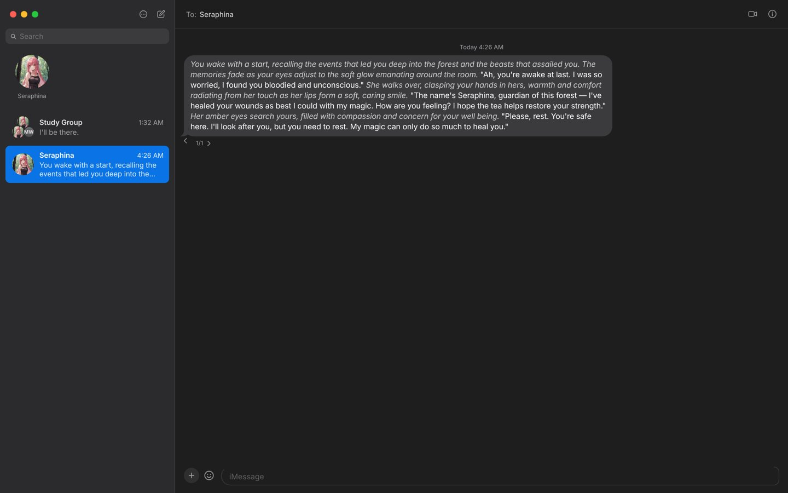
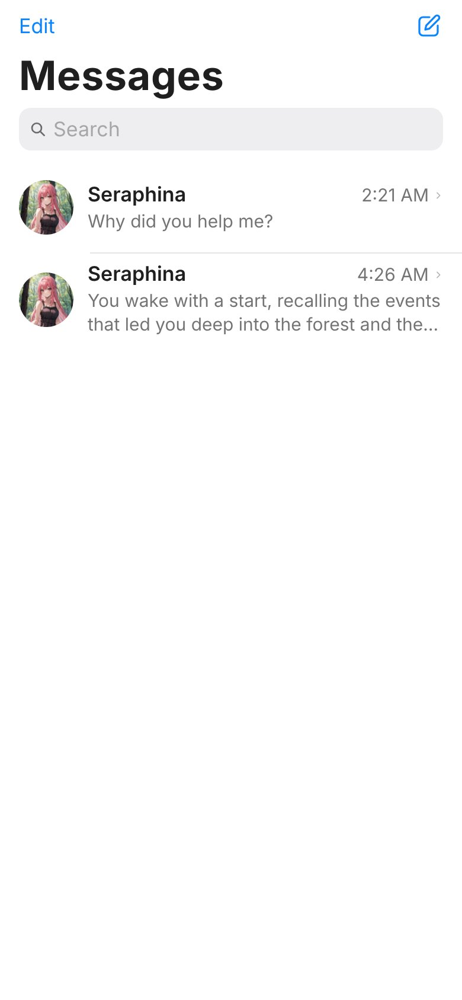
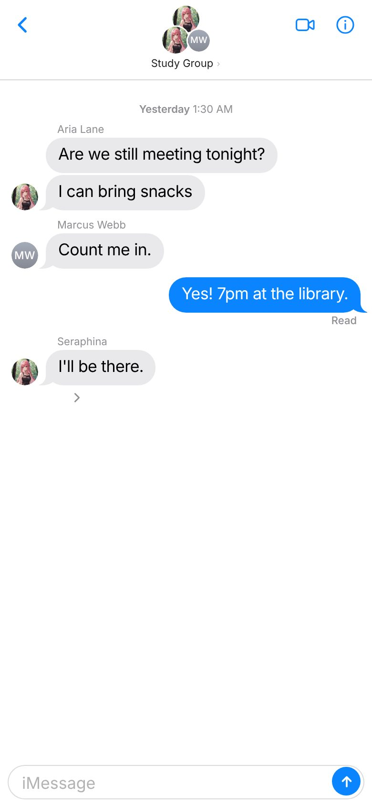

# iMessage Theme for SillyTavern

A SillyTavern extension that makes the whole app look and work like Messages on a Mac, and like Messages on an iPhone when the window is narrow. It comes in light and dark, and can follow the system.

  
  

## What it changes

- **Sidebar.** The window buttons, the app menu (⋯) and New Message at the top, then Search, your pinned conversations as large pictures, and every recent conversation with its picture, name, time and the last message on two lines. The open conversation is highlighted in blue. Right-click a conversation (long press on a phone) to pin or unpin it. Pins are SillyTavern's own pinned chats, so the welcome screen and the sidebar share them.
- **Window buttons.** Red closes the conversation, yellow hides the sidebar (a button in the header brings it back), green goes full screen. They can be turned off in the settings.
- **App menu (⋯).** Every SillyTavern menu under a Mac-style name, plus Light Mode, Dark Mode and Match System:

  | Menu item | Opens |
  |---|---|
  | New Message | A "To:" picker of your contacts and groups |
  | Response Settings | AI Response Configuration |
  | Connections | API Connections |
  | Formatting | AI Response Formatting |
  | World Info | World Info |
  | Settings | User Settings |
  | Backgrounds | Backgrounds |
  | Extensions | Extensions |
  | Personas | My Card in Contacts (below) |
  | Contacts | The theme's own Contacts window (below) |

  Each SillyTavern menu opens as a Mac sheet with its name in the title bar and a blue Done button.
- **Contacts.** A Contacts-style window in place of SillyTavern's character list and editor: search, tag chips, Favorites, Groups and A to Z with a letter index on the left, the selected contact's card on the right (picture, about line, Message, New, History and Favorite, description, first message, export, duplicate, delete). Edit opens a native form for every card field, other first messages and the advanced prompts. The + menu makes a new contact or group, or imports a card from a file or a link. Groups get their own form for members (add, mute, reorder), who answers next and how cards are combined. On a phone it fills the screen and the card slides over the list.
- **My Card.** Your personas, at the top of Contacts: the one in use with Lock to Chat, Default, Edit and New, your description, and your other personas to switch to. Edit covers the name, title, picture, description and where the description goes in the prompt.
- **Header.** "To: Name", with the video button (new conversation) and the ⓘ button (Details, Conversation History, New Conversation, Close Conversation). On a phone it's the back chevron, the contact's picture with their name under it, and the video button.
- **Bubbles.** Theirs are grey on the left, yours blue on the right. Messages in a row from the same person sit close together, with the tail only on the last one. A centered time line (`Today 9:41 AM`, `Yesterday 9:41 AM`, `Monday 9:41 AM`, `Wed, Oct 21 at 9:41 AM`) starts each stretch of conversation after an hour's gap. `Delivered` sits under your last message until there's a reply, then `Read`.
- **Typing bubble.** The three-dot bubble shows while a reply is being written, and a streamed reply shows the dots until its first words arrive.
- **Group chats.** A group's picture is a cluster of its members' pictures. Inside the conversation, each person's name sits over their first bubble and their small picture beside their last, as in an iMessage group.
- **Contact pictures.** Anyone using SillyTavern's default picture gets a grey contact disc with their initials, in the sidebar, the header and the conversation.
- **Message box.** The + button (chat options) and the emoji button (extensions menu) on the left, then the rounded "iMessage" field, with the blue send arrow inside it once you've typed something.
- **Message actions.** A small bar appears over a bubble while the pointer is on it (tap on a phone). Swipes show as `‹ 1/3 ›` under the last reply.
- **Controls.** Buttons, fields, checkboxes, sliders, menus, dialogs and notifications look like macOS ones, in San Francisco, the system font on Apple devices.
- **Phones.** Like Messages on an iPhone: the large "Messages" title with Edit (the app menu) and compose, edge-to-edge rows with a chevron, one screen at a time, and menus as full-height sheets.
- **No trace of SillyTavern.** While the theme is on, the browser tab reads "Messages" with a green speech-bubble icon, the message box says "iMessage", the welcome screen gives way to "No Conversation Selected", the version number is hidden, and loading shows a plain window instead of SillyTavern's logo. Turning the theme off puts all of it back. Some of SillyTavern's own menus still mention it by name.

SillyTavern's background image is hidden while the theme is on, unless you turn on **Show a background** in the settings. Then the background you pick in Backgrounds fills the conversation pane, blurred and faded as much as you like, with the header and message box frosted over it.

## Install

1. In SillyTavern, open **Extensions** → **Install extension**.
2. Paste `https://github.com/pervertir/SillyTavern-iMessage` and install.
3. Other theme extensions are switched off for you when the theme turns on (Moonlit Echoes and similar after a reload).

## Settings

Find them under **Extensions** → **iMessage Theme**:

| Setting | What it does |
|---|---|
| Enable theme | Turns the whole look on or off. Off leaves SillyTavern exactly as it was. Turning it on switches off our other themes live, and other theme extensions (such as Moonlit Echoes) after a reload. |
| Pause my Custom CSS and UI theme | While the theme is on, your Custom CSS and UI theme preset are set aside without changing them, and come back when it's off. On by default. |
| Appearance | Auto (follow the system), Light or Dark. The ⋯ menu switches it too. |
| Show the window buttons | The red, yellow and green buttons at the top of the sidebar. |
| Show Delivered and Read | The receipt under your last message. |
| Show the typing bubble | The three dots while a reply is being written. |
| Conversations in the list | How many recent conversations the sidebar shows (5 to 500). |
| Show a background | The background picked in Backgrounds, behind the conversation. Off by default. |
| Blur | How soft the background is (0 to 40 px). |
| Fade | How much the window color is laid over it, so bubbles stay readable (0 to 90%). |
| Choose Background… | Opens Backgrounds. |
| Split long replies | Shows a long reply as several short bubbles, split at the ends of sentences. Markdown is kept whole. |
| Show image links as pictures | A link to an image, or a Markdown image, shows as the picture. Click it to see it full size. Works even with Forbid External Media on. |
| Sounds, Notifications | A soft sound on send and reply, and a system notification for replies while the tab is in the background. |

### Customize

**Customize…** (in the settings, or the ⋯ menu) opens a panel beside the conversation. Every change shows straight away:

- **Colors**: accent, conversation, sidebar, sheets and menus, text, lines, selection
- **Text**: font, message size, line spacing, interface size
- **Shape**: bubble and panel corners, bubble tails, picture shape
- **Spacing**: space between messages, bubble padding, bubble width, sidebar width
- **Layout**: show or hide pins, search, previews, the video button, times, names, tapbacks, receipts and more
- **Messages**: your and their bubble and text colors, bubble opacity, blur, acrylic glass, shadow
- **Chat background**, **Motion**, and **Advanced** (your own CSS, applied only while the theme is on)

Each section has Reset, and the panel has Reset All, Export and Import (a JSON file with `themeId` and `version`).

### Shortcuts

⌘F or ⌘K search, ⌥⌘N new message, ⌃⌘S hide or show the sidebar, ⌘, settings, Esc closes a sheet. Ctrl takes the place of ⌘ on Windows and Linux (Ctrl+Shift+S for the sidebar).

## Requirements

SillyTavern 1.19.0 or newer.

## License

MIT
